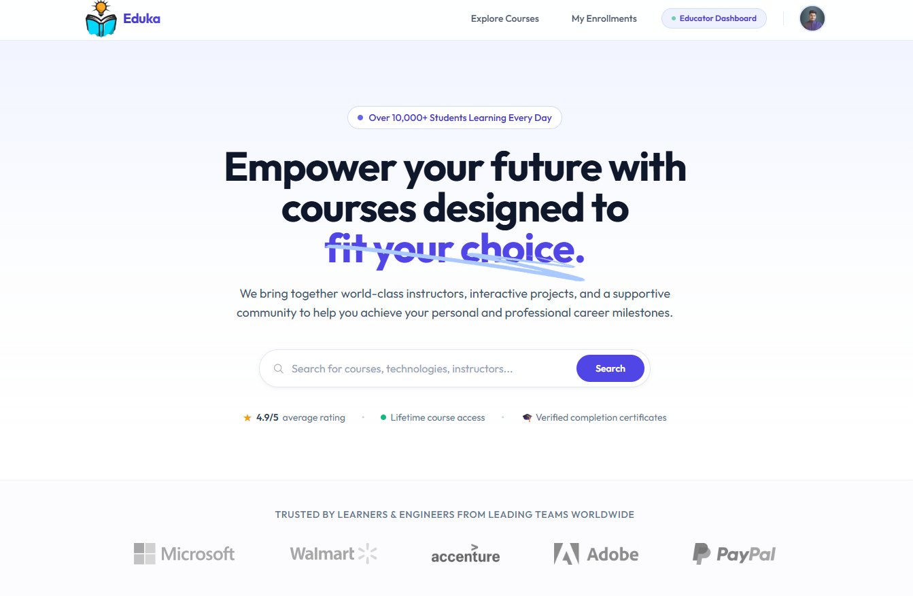

<div align="center">


# Eduka: Full-Stack Learning Management System

A full-stack online learning platform where **educators publish video courses** and **students buy, watch and track them**. It is built with the MERN stack and uses Clerk for authentication, Stripe for payments and Cloudinary for media.


<!-- Add your live link here -->
**[Live Demo](#)** · **[Report a Bug](https://github.com/ahammedhridoy/MERN_Stack_LMS_Website/issues)**

</div>

---

## 📸 Preview

<!-- Replace the path below with your screenshot -->


---

## 📖 About the Project

Eduka is a two-sided marketplace for online courses, similar in spirit to Udemy:

- **Students** browse and search the catalog, preview free lectures, pay securely through Stripe, watch lectures in a built-in player, mark lectures as complete, track their progress and rate the courses they take.
- **Educators** switch their account to the educator role in one click. They can then build courses chapter by chapter with a rich-text editor, upload thumbnails, set prices and discounts, and follow their earnings and enrolled students from a dashboard.

Building it meant handling real production concerns: third-party authentication with webhook-based user sync, role-based access control, a payment flow that confirms each purchase through a verified webhook, cloud media storage and deployment on Vercel.

---

## ✨ Features

### 👨‍🎓 For Students
- 🔐 **Secure sign-up and login** with Clerk (email or social login)
- 🔎 **Course catalog and search**, with search terms kept in the URL (`/course-list/:input`)
- 📄 **Detailed course pages** showing the chapter and lecture breakdown, total duration, ratings and the discounted price
- ▶️ **Free preview lectures**, played inline with the YouTube player
- 💳 **Stripe Checkout** for paying for courses
- 📚 **My Enrollments** page with a progress bar for each course
- 🎬 **Course player** where students mark lectures as completed
- ⭐ **1–5 star ratings** for enrolled courses

### 👩‍🏫 For Educators
- 🚀 **One-click switch to the educator role**, stored in Clerk public metadata
- 📊 **Dashboard** showing total earnings, total courses and the latest enrollments
- ➕ **Course builder**: add, collapse and remove chapters and lectures, with a Quill rich-text description and thumbnail upload to Cloudinary
- 🗂️ **My Courses** page listing each course's price, students and earnings
- 👥 **Students Enrolled** page showing who bought which course and when

### ⚙️ Under the Hood
- 🛡️ **Role-based route protection**: educator APIs check the role through `protectEducator` middleware
- 🔁 **Clerk webhooks** (verified with Svix) keep MongoDB users in sync on create, update and delete
- 💰 **Stripe webhooks** confirm payments and update the purchase status
- 🧪 **Unit tests** with Vitest for the course-builder chapter logic
- ☁️ **Deployed on Vercel**, with the frontend and backend as separate projects

---

## 🛠️ Tech Stack

| Layer | Technologies |
|---|---|
| **Frontend** | React 19, Vite 7, React Router 7, Tailwind CSS, Axios, Context API |
| **UI Libraries** | Quill (rich-text editor), React YouTube, rc-progress, React Toastify, humanize-duration |
| **Backend** | Node.js, Express 5, Mongoose 8, Multer |
| **Database** | MongoDB Atlas |
| **Auth** | Clerk (`@clerk/clerk-react`, `@clerk/express`), Svix webhook verification |
| **Payments** | Stripe Checkout and Stripe webhooks |
| **Media** | Cloudinary |
| **Testing and Tooling** | Vitest, ESLint, Nodemon |
| **Deployment** | Vercel |

---

## 🏗️ Architecture

```
┌──────────────────────┐        REST (Axios + Clerk JWT)        ┌──────────────────────┐
│   React + Vite SPA   │ ─────────────────────────────────────▶ │   Express 5 API      │
│  (Student/Educator)  │ ◀───────────────────────────────────── │  /api/course         │
└─────────┬────────────┘                                        │  /api/user           │
          │                                                     │  /api/educator       │
          │ Sign in                                             └──┬───────┬───────┬───┘
          ▼                                                        │       │       │
   ┌─────────────┐     user.created / updated / deleted            │       │       │
   │    Clerk    │ ──────────── POST /clerk (Svix) ──────────────▶ │       │       │
   └─────────────┘                                                 ▼       ▼       ▼
   ┌─────────────┐     payment_intent.succeeded               MongoDB  Cloudinary  Stripe
   │   Stripe    │ ──────────── POST /stripe ───────────────▶  (Mongoose)  (images)  (checkout)
   └─────────────┘
```

**Purchase flow:** the student clicks *Enroll* → `POST /api/user/purchase` creates a `Purchase` record and a Stripe Checkout session → Stripe redirects back to `/loading/my-enrollments` → the Stripe webhook confirms the payment and marks the purchase `completed`.

---

## 📁 Project Structure

```
MERN_Stack_LMS_Website/
├── backend/
│   ├── configs/          # MongoDB, Cloudinary and Multer setup
│   ├── controllers/      # course, educator, user and webhook handlers
│   ├── middlewares/      # protectEducator (role check)
│   ├── models/           # User, Course, Purchase, CourseProgress
│   ├── routes/           # /api/course, /api/user, /api/educator
│   ├── server.js         # Express entry point
│   └── vercel.json
│
└── frontend/
    ├── src/
    │   ├── assets/       # images, icons and dummy data
    │   ├── components/
    │   │   ├── student/  # Navbar, Hero, CourseCard, SearchBar, Rating ...
    │   │   └── educator/ # Navbar, Sidebar, Footer
    │   ├── context/      # AppContext and AppProvider (global state)
    │   ├── pages/
    │   │   ├── student/  # Home, CoursesList, CourseDetails, MyEnrollments, Player
    │   │   └── educator/ # Dashboard, AddCourse, MyCourses, StudentsEnrolled
    │   ├── App.jsx       # routes
    │   └── main.jsx
    ├── tests/            # Vitest unit tests
    └── vercel.json
```

---

## 🔌 API Reference

| Method | Endpoint | Auth | Description |
|---|---|---|---|
| `GET` | `/api/course/all` | Public | List all published courses |
| `GET` | `/api/course/:id` | Public | Get one course's details |
| `GET` | `/api/user/all` | User | Get the logged-in user's profile |
| `GET` | `/api/user/enrolled-courses` | User | List the user's enrolled courses |
| `POST` | `/api/user/purchase` | User | Create a Stripe Checkout session |
| `POST` | `/api/user/update-course-progress` | User | Mark a lecture as completed |
| `POST` | `/api/user/get-course-progress` | User | Get progress for a course |
| `POST` | `/api/user/add-rating` | User | Rate an enrolled course |
| `GET` | `/api/educator/update-role` | User | Switch the account to the educator role |
| `POST` | `/api/educator/add-course` | Educator | Create a course (multipart, with an `image` file) |
| `GET` | `/api/educator/courses` | Educator | List the educator's courses |
| `GET` | `/api/educator/dashboard` | Educator | Get earnings, course count and enrollments |
| `GET` | `/api/educator/enrolled-students` | Educator | List students and their purchase dates |
| `POST` | `/clerk` | Svix signature | Clerk user-sync webhook |
| `POST` | `/stripe` | Stripe signature | Stripe payment webhook |

---

## 🗄️ Data Models

- **User**: Clerk ID, name, email, avatar, enrolled courses
- **Course**: title, description, thumbnail, price, discount, nested **chapters → lectures** (title, duration, URL, free preview flag, order), ratings, educator, enrolled students
- **Purchase**: course, user, amount, status (`pending` / `completed` / `failed`)
- **CourseProgress**: user, course, completed lectures, completed flag

---

## 🚀 Getting Started

### Prerequisites
- Node.js 18 or later
- A MongoDB Atlas cluster
- Accounts for [Clerk](https://clerk.com), [Stripe](https://stripe.com) and [Cloudinary](https://cloudinary.com)

### 1. Clone the repository
```bash
git clone https://github.com/ahammedhridoy/MERN_Stack_LMS_Website.git
cd MERN_Stack_LMS_Website
```

### 2. Set up the backend
```bash
cd backend
npm install
```
Create `backend/.env`:
```env
PORT=5000
MONGODB_URI=your_mongodb_connection_string
CURRENCY=USD

CLERK_PUBLISHABLE_KEY=your_clerk_publishable_key
CLERK_SECRET_KEY=your_clerk_secret_key
CLERK_WEBHOOK_SECRET=your_clerk_webhook_secret

CLOUDINARY_NAME=your_cloud_name
CLOUDINARY_API_KEY=your_cloudinary_api_key
CLOUDINARY_API_SECRET=your_cloudinary_api_secret

STRIPE_PUBLISHABLE_KEY=your_stripe_publishable_key
STRIPE_SECRET_KEY=your_stripe_secret_key
STRIPE_WEBHOOK_SECRET=your_stripe_webhook_secret
```
```bash
npm run dev
```

### 3. Set up the frontend
```bash
cd ../frontend
npm install
```
Create `frontend/.env`:
```env
VITE_CLERK_PUBLISHABLE_KEY=your_clerk_publishable_key
VITE_BACKEND_URL=http://localhost:5000
VITE_CURRENCY=$
```
```bash
npm run dev
```
The app runs at **http://localhost:5173**.

### 4. Configure the webhooks
- **Clerk** → Webhooks → endpoint `https://<your-backend>/clerk`, with the events `user.created`, `user.updated` and `user.deleted`
- **Stripe** → Webhooks → endpoint `https://<your-backend>/stripe`, with the event `payment_intent.succeeded`

> 💡 For local testing, use `stripe listen --forward-to localhost:5000/stripe`, and expose the backend with a tunnel (for example ngrok) for Clerk.

### 5. Run the tests
```bash
cd frontend
npm test
```

---

## 📜 Available Scripts

| Location | Command | Description |
|---|---|---|
| `backend` | `npm run dev` | Start the API with Nodemon |
| `backend` | `npm start` | Start the API in production mode |
| `frontend` | `npm run dev` | Start the Vite dev server |
| `frontend` | `npm run build` | Build for production |
| `frontend` | `npm run preview` | Preview the production build |
| `frontend` | `npm run lint` | Run ESLint |
| `frontend` | `npm test` | Run the Vitest unit tests |

---

## 🧠 What I Learned

- Integrating **third-party authentication** (Clerk) and keeping a local database in sync through **signed webhooks**
- Building a **payment flow** with Stripe Checkout and confirming each purchase from the server through webhooks
- Designing **nested MongoDB schemas** (course → chapters → lectures) and tracking each user's progress
- Protecting APIs with **role-based authorization**
- Managing global state in React with the **Context API**, and unit-testing UI logic with **Vitest**
- Deploying a split frontend and backend on **Vercel**

---

## 👤 Author

**Ahammed Hridoy**

- GitHub: [@ahammedhridoy](https://github.com/ahammedhridoy)
<!-- - LinkedIn: [your-linkedin](https://linkedin.com/in/your-linkedin) -->
<!-- - Portfolio: [your-portfolio](https://your-portfolio.com) -->

---

<div align="center">

⭐ If you like this project, consider giving it a star!

</div>
